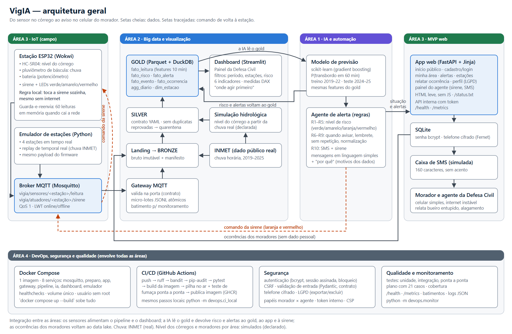

# VigIA — alerta comunitário de enchentes

**Global Solution 2026/2 · CitizenTech · FIAP · Engenharia de Software · 4ESOA · Grupo 14**

> Quem mora perto de córrego só descobre que vai alagar quando a água já está na porta.
> O VigIA mede o nível do córrego e a chuva, **prevê o transbordo com até 1 hora de antecedência** e avisa o morador
> em linguagem simples — no celular, por SMS e pela sirene da própria estação, mesmo com internet ruim.

**Vídeo pitch (3 min):** [A PREENCHER — link público do YouTube/Drive]

| Integrante | RM |
|---|---|
| Lucas Dalmas Batista e Souza | RM551178 |
| Lucas Emanuel de Mélo Silva | RM97881 |
| Kayque Moraes Dias | RM97592 |
| Lucas Moraes Henklain da Silva | RM99350 |
| Vinicius Pinheiro | RM99198 |

O PDF com a solução, a arquitetura e as evidências de cada área está em [`VigIA_Grupo14_Entregaveis.pdf`](VigIA_Grupo14_Entregaveis.pdf); os integrantes e o link do pitch, em [`Grupo14_integrantes.txt`](Grupo14_integrantes.txt).

---

## 1. O problema, o cidadão e os ODS

- **Cidadão:** famílias que moram às margens de córregos urbanos em área de risco (celular simples, internet instável)
  e o agente da Defesa Civil que precisa decidir onde agir primeiro.
- **Dado real:** mais de 8,9 milhões de brasileiros vivem em áreas de risco em 1.942 municípios; de 1991 a 2022 foram
  3.890 mortes e 8,2 milhões de desalojados ou desabrigados por inundações, enxurradas e deslizamentos
  (nota técnica da Casa Civil, divulgada pela [Agência Brasil em maio/2024](https://agenciabrasil.ebc.com.br/geral/noticia/2024-05/brasil-tem-1942-cidades-com-risco-de-desastre-ambiental)).
  Aviso antecipado reduz danos em até 30% (Global Commission on Adaptation, citada pela OMM).
- **ODS:** 11.5 (reduzir mortes e afetados por desastres), 13.1 (resiliência a riscos climáticos), 3.d (alerta precoce de
  riscos à saúde), 10.2 (inclusão: funciona para quem tem celular simples), 9.c (acesso à tecnologia da informação).

**O que é real e o que é simulado:** a **chuva** é medição real do INMET (estações A701 Mirante de Santana e A771
Interlagos, 2019–2025). O **nível dos córregos**, as 4 estações e o número de moradores por área são **simulados**
(modelo chuva-vazão em `dados/simulacao/hidrologia.py`). Os números da IA valem para esse cenário simulado.

## 2. Arquitetura



As áreas são **integradas**: os sensores alimentam o pipeline e o dashboard; a IA lê o *gold* do pipeline e devolve
risco e alertas ao *gold*, ao app e à sirene; as ocorrências relatadas pelos moradores voltam ao data lake.

| Pasta | Área do enunciado | O que tem |
|---|---|---|
| [`ia/`](ia) | 1 · IA e automação | modelo de previsão (`treinar.py`), avaliação antes × depois (`avaliacao.py`), agente de alerta por regras (`agente.py`), mensagens (`mensagens.py`), serviço em tempo real (`servico.py`) |
| [`dados/`](dados) | 2 · Big data e visualização | contrato de dados, gateway MQTT, data lake bronze/silver/gold, medidas estilo DAX (`medidas.py`), dashboard Streamlit |
| [`mvp/`](mvp) | 3 · MVP, IoT e experiência digital | `web/` app FastAPI (10+ telas), `iot/` firmware ESP32 para Wokwi e emulador de estações |
| [`devops/`](devops) | 4 · DevOps, segurança e qualidade | Docker, CI local, monitoramento, teste de fumaça, plano de testes |
| `comum/` · `tests/` · `docs/` | apoio | configuração e log · testes automatizados · PDF, diagramas, evidências, guias |

## 3. Como executar

Pré-requisito: **Python 3.11+** (testado no 3.13). Tudo roda a partir da raiz do projeto.

```bash
pip install -r requirements.txt
```

```bash
python -m devops.preparar
```

O `preparar` leva cerca de 3 minutos na primeira vez: monta o histórico do data lake (INMET → bronze → silver → gold),
treina e avalia a IA, gera os alertas retroativos do dashboard e cria os usuários de demonstração. Rodar de novo é rápido.

### 3.1 Tudo de uma vez (recomendado para avaliar)

**Com Docker** (broker MQTT de verdade, 8 serviços):

```bash
docker compose up --build
```

**Sem Docker** (só Python; as leituras vão direto ao gateway, sem broker):

```bash
python -m devops.demo
```

Nos dois casos: app do morador em <http://localhost:8000>, painel da Defesa Civil em <http://localhost:8501>
(escolha a fonte **"Sensores ao vivo"**). As estações simuladas reproduzem, acelerado, o temporal real de 24/01/2025:
em cerca de 2 minutos o app mostra o risco subindo, o alerta da IA, o SMS na fila e a sirene acionada.
Portas ocupadas? Copie `.env.example` para `.env` e troque as portas (Docker) ou use
`python -m devops.demo --porta-app 8010 --porta-painel 8511`.

Usuários de demonstração (criados pelo seed; detalhes em [`mvp/web/README.md`](mvp/web/README.md)):
morador `morador@exemplo.com` e agente `agente@exemplo.com`.

### 3.2 Cada área sozinha

**Área 1 — IA e automação**

```bash
python -m ia.treinar
```

```bash
python -m ia.demonstrar
```

```bash
python -m ia.demonstrar --nivel 60 --chuva-1h 45 --subida-30min 20
```

`treinar` imprime a tabela antes × depois e grava `ia/modelos/metricas.json`. `demonstrar` mostra uma entrada
(janela de 10 min) e a saída (probabilidade, nível de risco, alerta completo, SMS e comando da sirene).

**Área 2 — Big data e visualização**

```bash
python -m dados.pipeline status
```

```bash
python -m streamlit run dados/dashboard/app.py
```

`status` lista arquivos e linhas por camada. O dashboard abre com a fonte "Histórico (2019–2025)"; os filtros
(fonte, período, estações, nível de risco) mudam todos os indicadores.

**Área 3 — MVP web e IoT**

```bash
python -m mvp.web.seed --demo
```

```bash
python -m uvicorn mvp.web.app:app --port 8000
```

O seed com `--demo` cria situações de exemplo para as telas não ficarem vazias sem o pipeline.
Sensores no Wokwi (ESP32 + ultrassônico HC-SR04 + pluviômetro de báscula): passo a passo de 3 minutos em
[`mvp/iot/firmware/README.md`](mvp/iot/firmware/README.md). Emulador das 4 estações (precisa de um broker MQTT):

```bash
python -m mvp.iot.emulador --cenario temporal
```

**Área 4 — DevOps, segurança e qualidade**

```bash
pip install -r requirements-dev.txt
```

```bash
python -m pytest
```

```bash
python -m devops.ci_local
```

```bash
python -m devops.monitor --uma-vez
```

`ci_local` executa os mesmos passos do pipeline de CI (`.github/workflows/ci.yml`): ruff, bandit, pip-audit e pytest
com cobertura; com `--com-docker`, também o build da imagem e o teste de fumaça da pilha inteira.
Os registros ficam em `docs/evidencias/ci_local/`.

## 4. O que cada área entrega

### Área 1 — IA e automação
- **IA aplicada:** modelo scikit-learn (gradient boosting) que estima a probabilidade de transbordo nos próximos
  60 minutos a partir de chuva acumulada, nível e ritmo de subida — as mesmas variáveis do *gold* do pipeline.
- **Agente de alerta (regras R1–R10, em `ia/agente.py`):** decide o nível (verde, amarelo, laranja, vermelho),
  quando avisar, quando lembrar, quando não repetir, quando normalizar, e aciona SMS e sirene.
- **Ganho medido** (teste 2024–2025, dados que o modelo nunca viu; 38 transbordos):

| Indicador | Antes: regra de limiar fixo | Depois: IA |
|---|---:|---:|
| Eventos avisados com 30 min ou mais | 23,7 % | **78,9 %** |
| Antecedência mediana do alerta | 10 min | **40 min** |
| Alarmes falsos no período | 61 | **41** |
| F1 por janela de 10 min | 0,28 | **0,57** |

  Tabela completa (incluindo a política implantada "IA + regra") em `ia/modelos/relatorio_avaliacao.md`.

### Área 2 — Big data e visualização
- **Camadas:** landing → bronze (bruto imutável com manifesto) → silver (contrato YAML, tipos, sem duplicata;
  reprovadas vão para a quarentena) → gold (features de 10 min, eventos, risco, alertas, ocorrências, agregado diário).
- **Ingestão:** arquivos reais do INMET e micro-lotes do gateway MQTT; 1,47 milhão de janelas no gold histórico.
- **Dashboard:** 6 indicadores com filtros, tabela "onde agir primeiro", série de nível × cotas, alertas por período,
  horário dos transbordos, antes × depois da IA e monitoramento do pipeline.
- **Funções analíticas:** `dados/medidas.py` (cada medida traz a fórmula DAX equivalente; versão para Power BI em
  `dados/powerbi/medidas.dax`).

### Área 3 — MVP, IoT e experiência digital
- **Telas:** início público, cadastro, login, minha área, alertas, detalhe do alerta, estações, detalhe da estação,
  relatar ocorrência, minhas ocorrências, perfil (LGPD) e painel do agente.
- **IoT:** ESP32 no Wokwi com 2 sensores (ultrassônico de nível e pluviômetro de báscula) + bateria, 3 LEDs e sirene;
  regra local que funciona sem internet; guarda-e-reenvia de 60 leituras; emulador Python das 4 estações.
- **Fluxo completo:** sensor → MQTT → pipeline → IA → alerta no app + SMS + sirene → morador relata ocorrência →
  agente atende no painel.
- **Conectividade ruim:** HTML leve sem JavaScript, `/status.txt` em texto puro, SMS de 160 caracteres sem acento,
  sirene decidida na própria estação.

### Área 4 — DevOps, segurança e qualidade
- **Organização:** um pacote por área, Git com commits pequenos.
- **DevOps:** `Dockerfile` + `docker-compose.yml` (8 serviços, healthchecks, usuário sem root), workflow do GitHub Actions
  (lint → segurança → testes → build → teste de fumaça da pilha → publicação da imagem), `/health`, `/metrics`,
  batimentos dos serviços e logs em JSON.
- **Segurança:** senha com bcrypt, sessão assinada, bloqueio após 5 tentativas, CSRF, validação de entrada
  (Pydantic no app, contrato no gateway e no silver), telefone cifrado (Fernet) e mascarado, papéis morador × agente,
  token na API interna, cabeçalhos de segurança, exportar e excluir dados (LGPD).
- **Testes:** plano com 21 casos em [`devops/qualidade/PLANO_DE_TESTES.md`](devops/qualidade/PLANO_DE_TESTES.md);
  testes automatizados de unidade, integração e ponta a ponta.

## 5. Fontes de dados

| Dado | Fonte | Situação |
|---|---|---|
| Chuva horária 2019–2025 | INMET, dados históricos anuais (<https://portal.inmet.gov.br/dadoshistoricos>), estações A701 e A771 | **real**; arquivos originais em `dados/fontes/inmet/` |
| Nível dos córregos | `dados/simulacao/hidrologia.py` | **simulado** a partir da chuva real |
| Estações, cotas, moradores por área | `dados/referencia/estacoes.csv` | **simulado** (córregos reais de São Paulo; pontos e números fictícios) |
| Usuários, telefones, ocorrências | seed e testes | fictícios (`@exemplo.com`) |

## 6. Uso de IA generativa (declaração)

| Ferramenta | Para quê |
|---|---|
| Claude (Anthropic), via Claude Code | apoio na escolha e pesquisa do problema, geração e revisão de código, testes, documentação, PDF e montagem do vídeo, sob direção e revisão da equipe |
| edge-tts (voz neural do Microsoft Edge) | narração do vídeo pitch |

Em tempo de execução **não há IA generativa**: a previsão é um modelo de machine learning treinado pela equipe
(scikit-learn) e as mensagens dos alertas são textos fixos revisáveis. O guia
[`docs/COMO_EXPLICAR.md`](docs/COMO_EXPLICAR.md) resume, área por área, como o código funciona — a equipe o usou para
revisar e entender tudo o que está sendo entregue.

**Reaproveitamento interno (com crédito):** a ideia de contratos de dados, o gateway MQTT, o firmware ESP32 no Wokwi,
o script de captura da simulação e o montador de vídeo foram adaptados de trabalhos anteriores da própria equipe
(projetos AgroSmart e Startup One, FIAP 2026). O problema, o produto, os dados e o código desta Global Solution são próprios.

## 7. Validação com pessoas reais

Roteiro de 5 minutos por pessoa em [`docs/validacao/ROTEIRO_VALIDACAO.md`](docs/validacao/ROTEIRO_VALIDACAO.md).
Os resultados reais ficam em `docs/validacao/respostas.csv` e na seção correspondente do PDF.

## 8. Problemas comuns

| Sintoma | Solução |
|---|---|
| Porta 8000, 8501 ou 1883 ocupada | `.env` com `VIGIA_PORTA_APP`, `VIGIA_PORTA_DASHBOARD`, `VIGIA_PORTA_MQTT` (Docker) ou `--porta-app/--porta-painel` (`devops.demo`) |
| `modelo não encontrado` | rode `python -m devops.preparar` (ou `python -m ia.treinar`) |
| `docker build` falha no `pip install` em rede corporativa com inspeção TLS | `docker build --secret id=ca_extra,src=cadeia.pem -t vigia:latest .` e depois `docker compose up` |
| Acentos quebrados no terminal do Windows | `set PYTHONUTF8=1` antes do comando |
| Quero repetir a demonstração do zero | `python -m devops.demo --limpar` (sem Docker) ou `docker compose down -v` e `docker compose up` (com Docker) |
